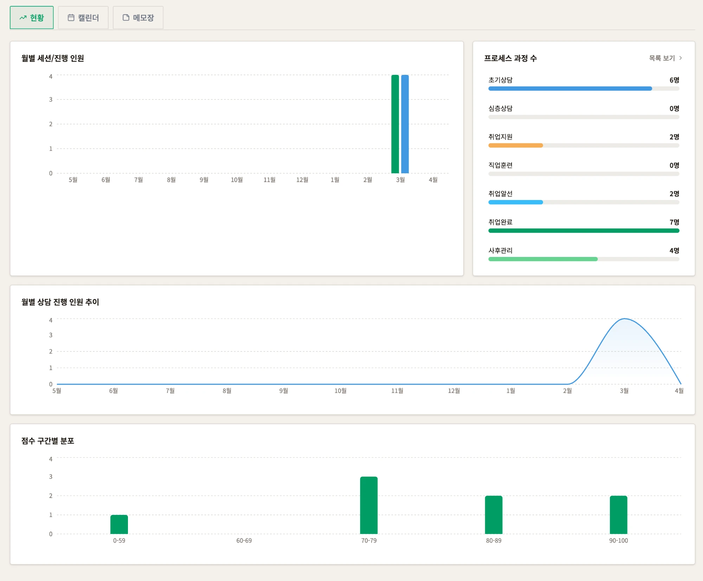
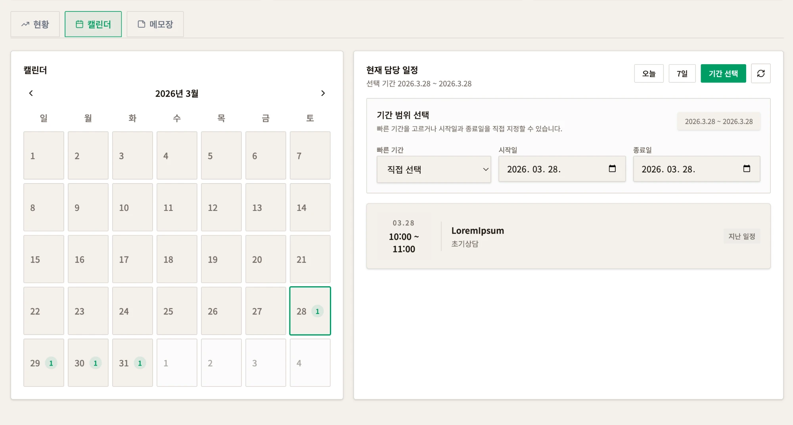
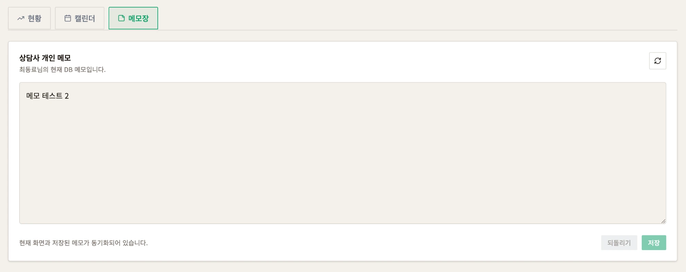
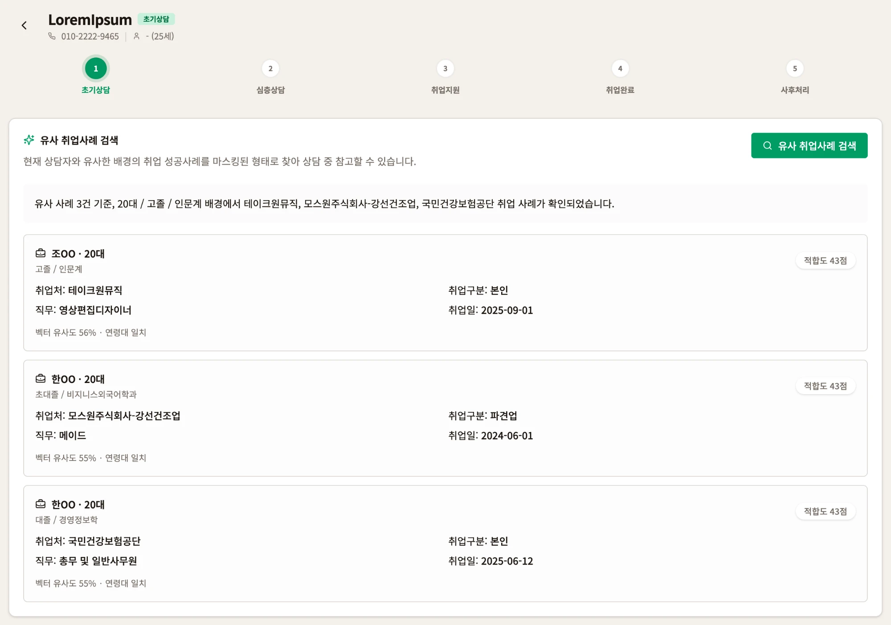
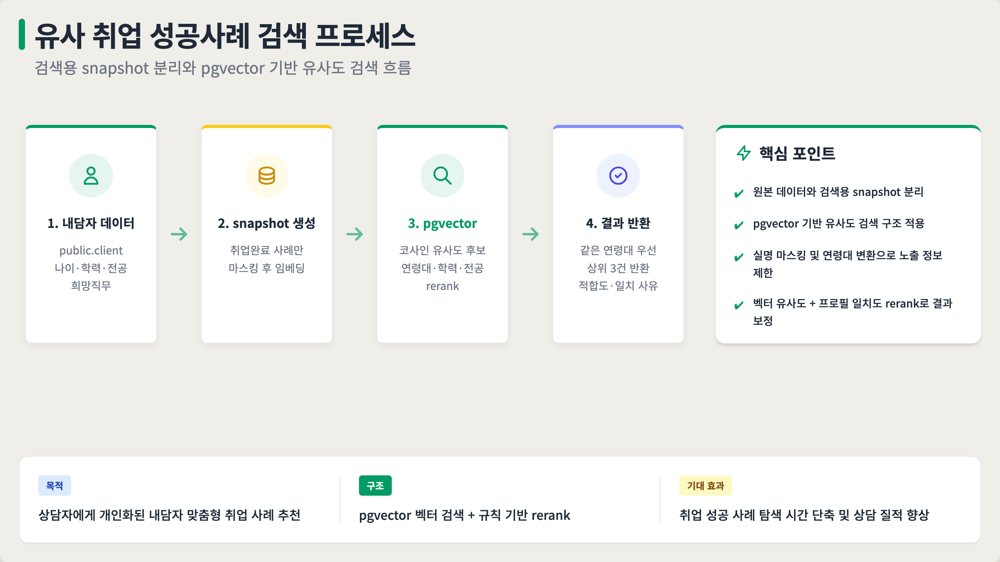
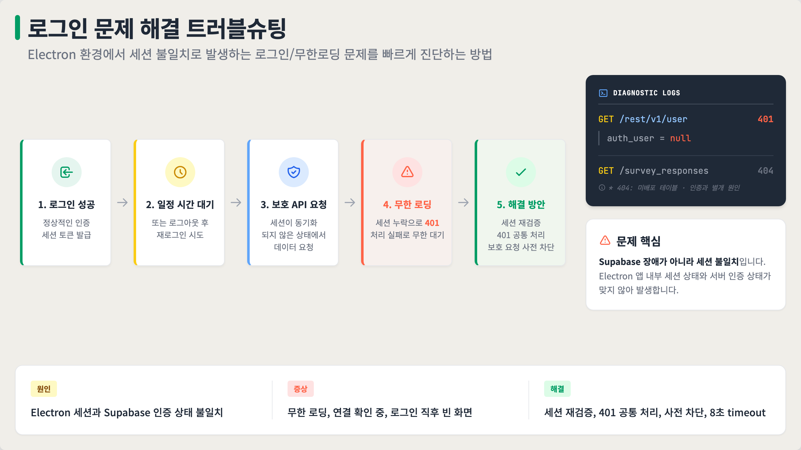

# ZeniManager — 개인 기여 포트폴리오

> 5인 팀 · 2026.03.25 ~ 03.31 PoC · 취업 지원 상담 관리 데스크탑/웹 앱
> 이 문서는 **제가 구현한 범위만** 다룹니다. 팀 전체 소개는 원본 저장소 [SuranS2/ZeniManager](https://github.com/SuranS2/ZeniManager) 또는 [README.team.md](./README.team.md)를 참고하세요.

`React 19` `TypeScript` `Vite` `Electron` `Supabase (PostgreSQL · RLS · Edge Functions · pgvector)` `OpenAI Embedding`

---

## 1. 왜 만들었나

취업 지원 사업의 상담 현장에서 정리한 문제는 세 가지였습니다.

- **현황 관리가 엑셀 중심**: 상담사가 담당자 진행 상황을 실시간으로 파악하기 어렵습니다.
- **상담 데이터가 비정형**: 상담사마다 기록 방식이 달라 유사 사례를 찾아 참고하기 어렵습니다.
- **역량 진단의 정량화 부족**: 구직준비도 점수가 흩어져 있어 상담 품질을 비교하기 어렵습니다.

저는 이 중 **상담사 업무 대시보드**(현황·점수·일정·메모)와 **유사 취업 성공사례 검색**을 맡았습니다.

## 2. 내 역할과 구현 근거

이슈는 원본 저장소, 커밋은 이 포크 기준 링크입니다.

| 영역 | 내용 | 이슈 | 커밋 |
|---|---|---|---|
| 대시보드 | 메모·캘린더 기능, 실제 DB 저장 연결 | #4 | [`46a52ed`](https://github.com/gmkoo-d3v/ZeniManager/commit/46a52ed) |
| | 캘린더 일정 흐름 | #12 | [`6dc5e08`](https://github.com/gmkoo-d3v/ZeniManager/commit/6dc5e08) |
| | 메모·캘린더 경계 수정, UI 정리 | [#19](https://github.com/SuranS2/ZeniManager/issues/19) | [`23e88e1`](https://github.com/gmkoo-d3v/ZeniManager/commit/23e88e1) · [`a155a48`](https://github.com/gmkoo-d3v/ZeniManager/commit/a155a48) |
| | 대시보드 DB 런타임 계약 강화 | [#20](https://github.com/SuranS2/ZeniManager/issues/20) | [`77b6c6d`](https://github.com/gmkoo-d3v/ZeniManager/commit/77b6c6d) |
| | 구직준비도 점수 KPI | [#23](https://github.com/SuranS2/ZeniManager/issues/23) | [`3073ec4`](https://github.com/gmkoo-d3v/ZeniManager/commit/3073ec4) |
| | 상담사 소유 데이터 접근 경계, 프로세스 단계 정규화 | [#25](https://github.com/SuranS2/ZeniManager/issues/25) | [`5a0f077`](https://github.com/gmkoo-d3v/ZeniManager/commit/5a0f077) · [`b85a11f`](https://github.com/gmkoo-d3v/ZeniManager/commit/b85a11f) |
| | 통계 회귀 복구, `api.ts`에서 대시보드 API 모듈 분리 | [#31](https://github.com/SuranS2/ZeniManager/issues/31) | [`2bcbbcb`](https://github.com/gmkoo-d3v/ZeniManager/commit/2bcbbcb) · [`e2debd0`](https://github.com/gmkoo-d3v/ZeniManager/commit/e2debd0) |
| | 대시보드·상담자 매핑 정합성 | [#41](https://github.com/SuranS2/ZeniManager/issues/41) | [`f2c4784`](https://github.com/gmkoo-d3v/ZeniManager/commit/f2c4784) |
| 유사 사례 검색 | pgvector 기반 유사 취업 성공사례 검색 (Edge Function 2개, SQL, 테스트) | [#33](https://github.com/SuranS2/ZeniManager/issues/33) | [`8402691`](https://github.com/gmkoo-d3v/ZeniManager/commit/8402691) |
| | 내담자 상세에서 취업 정보 수정 시 성공사례 snapshot 갱신, 앱 설정의 OpenAI 키를 요청에 담아 사용 | [#39](https://github.com/SuranS2/ZeniManager/issues/39) | [`21f5fb0`](https://github.com/gmkoo-d3v/ZeniManager/commit/21f5fb0) · [`a6a684c`](https://github.com/gmkoo-d3v/ZeniManager/commit/a6a684c) |
| 인증 안정화 | Electron Supabase 세션 401 · 무한 로딩 대응 | [#36](https://github.com/SuranS2/ZeniManager/issues/36) | [`2e59225`](https://github.com/gmkoo-d3v/ZeniManager/commit/2e59225) · [PR #38](https://github.com/SuranS2/ZeniManager/pull/38) |

내 담당이 아닌 부분: 로그인 화면, 관리자 포털, 문서 업로드·HWP 정규화, AI 요약·점수화 프롬프트, 상담 챗봇 응답 생성.

## 3. 화면

### 3-1. 상담사 업무 대시보드

- 상단 4개 카드는 담당 상담자의 진행 단계 집계, 하단 3개 카드는 구직준비도 점수 KPI입니다 (#23, #25).
- 사이드바 하위 메뉴가 현황·캘린더·메모장 탭으로 바로 연결됩니다 (#4, #19).

### 3-2. 상세 차트 — 현황 탭

- 월별 세션·진행 인원, 프로세스 단계별 인원, 점수 구간 분포를 시각화했습니다 (#23, #31).
- 프로세스 단계명은 DB 값을 정규화해 집계합니다 (#25).

### 3-3. 캘린더와 개인 메모

- `오늘` · `7일` · `기간 선택`으로 고른 범위가 우측 일정 목록과 좌측 달력 강조에 똑같이 반영됩니다 (#19).

- 상담사 개인 메모는 `public.user.memo`에 저장하고, 저장 후 다시 조회해 화면과 DB가 일치하는지 표시합니다 (#4).

### 3-4. 유사 취업사례 검색

- 내담자 상세 화면에서 비슷한 배경의 취업 성공사례를 찾아 보여줍니다 (#33).
- 이름은 `성 + OO`, 나이는 연령대로만 노출합니다.
- 카드마다 rerank 점수인 `적합도`와 일치 사유(벡터 유사도 %, 연령대·학력·전공 일치)를 표시합니다.

## 4. 유사 취업 성공사례 검색 구조

- 원본 `public.client`와 검색용 snapshot `public.employment_success_case`를 분리했습니다. 이름은 `성 + OO`, 나이는 연령대로 바꿔 snapshot에 저장하므로 원본 개인정보가 검색 결과에 나가지 않습니다.
- snapshot은 `취업완료` 단계이면서 취업처가 있는 내담자만 만듭니다. 상세 화면이나 목록에서 단계·취업 정보를 바꾸면 `sync-employment-success-case`가 다시 실행되어 활성화하거나 비활성화합니다.
- 임베딩은 `text-embedding-3-small`(1536차원)이고, 외부 벡터스토어 없이 PostgreSQL + pgvector(HNSW, cosine)만 사용했습니다.
- 데이터가 적을 때 벡터 유사도만으로는 연령대가 다른 사례가 섞였습니다. 그래서 후보를 넉넉히(요청 수 × 3, 최소 10건) 뽑은 뒤 연령대·학력·전공 일치도로 rerank 하고, 같은 연령대 결과를 우선 반환합니다.

## 5. 트러블슈팅

### 5-1. Electron 세션 401과 무한 로딩 — [Issue #36](https://github.com/SuranS2/ZeniManager/issues/36) · [PR #38](https://github.com/SuranS2/ZeniManager/pull/38)

- **증상**: 30초 이상 대기하거나 재로그인하면 `GET /rest/v1/user`가 `401`, `auth_user = null`로 실패했습니다. 화면은 로딩 스피너에 멈췄고, 재로그인 직후 빈 화면이 나오기도 했습니다.
- **진단**: 요청 로그를 나눠 보니 `/rest/v1/user`는 `auth_user = null`인 `401`이었습니다. 반면 `survey_responses`의 `404`는 인증이 정상인 상태에서 미배포 테이블을 조회한 별개 문제였습니다. 그래서 Supabase 장애가 아니라 앱 세션과 서버 인증 상태가 어긋난 문제로 범위를 좁혔습니다.
- **원인**
  - 세션 저장소와 Supabase 클라이언트 상태가 어긋나 보호 요청이 익명으로 나갔습니다.
  - 로그인 직후 프로필 조회가 토큰 없이 실행되는 타이밍 문제가 있었습니다.
  - 이전 인증 작업의 늦은 응답이 현재 상태를 덮어썼습니다.
- **해결**
  - 렌더링 전에 Electron 저장 설정을 초기화하고 Supabase 클라이언트를 재사용
  - auth revision guard로 지난 인증 결과를 무시
  - 로그아웃 시 `sessionStorage`·`localStorage` 잔여 토큰 정리
  - 화면 복귀·창 포커스 때와 20초 주기로 세션 재검증
  - 저장된 세션이 없으면 보호 요청을 보내기 전에 차단하고, 401 응답은 공통 세션 만료 처리로 로그인 화면에 보냄
  - 모든 보호 요청에 8초 timeout 적용
  - access token을 명시한 프로필 조회 fallback
  - 선택 기능 테이블(`survey_responses`)이 없어도 전체 화면이 깨지지 않도록 처리
- **검증**: `supabase.test.ts`, `authProfile.test.ts` 단위 테스트 추가 후 dev에 병합했습니다.

### 5-2. 저장은 됐는데 실패로 보이는 문제 — RLS · 스키마 정합성 ([`46a52ed`](https://github.com/gmkoo-d3v/ZeniManager/commit/46a52ed))

| 증상 | 원인 | 해결 |
|---|---|---|
| 메모 저장 후 "값을 다시 확인하지 못했습니다" | `public.user`에 UPDATE 권한은 있지만 RLS UPDATE policy가 없음 | `public.user.memo`로 경로 통일, `supabase_user_rls.sql` 정책 보강 |
| 피상담자 등록 성공 표시, DB row 없음 | 등록 화면이 `setTimeout` 기반 임시 submit | `createClient()` 실제 insert 연결, DB 오류를 toast로 노출 |
| 설정 화면 연결 확인 `404` | 존재하지 않는 `public.counselors` 조회 | `public.user` 기준 헬스체크로 변경 |

배운 점: 화면의 성공 메시지만 믿지 않고 권한, RLS 정책, 실제 schema, 후속 조회를 각각 확인해야 합니다.

## 6. 발표 피드백과 한계 (미반영)

PoC 발표회에서 IT 실무자에게 아래 피드백을 받았습니다. 발표회 이후 팀이 해산해 **반영하지 못했습니다.**

| 지적 | 현재 상태 | 운영 전환 시 필요 |
|---|---|---|
| `public` 스키마 직접 노출 | 앱이 `public` 테이블을 PostgREST로 직접 조회 | 전용 스키마 분리, API 계층 또는 RPC로 접근 제한 |
| 데이터 검증·예외 처리 | 프론트 위주 검증 | 서버 측 검증과 일관된 오류 규칙 |
| 레이아웃·가독성 | 데스크탑 기준, 디자인 토큰 미정의 | rem 기반 토큰, 기기별 레이아웃 |
| 동시 접속 규모 | 산정 없음 | 예상 사용자 수 기반 용량 산정 |
| 상담 이력 관리 | 최신 상태만 저장 | 변경 이력 보관 정책 |

회고: 기능 구현만으로는 부족하고, 상담 업무 흐름을 이해한 상태에서 설계해야 한다는 점을 배웠습니다. 성과도 숫자로 설명할 수 있어야 합니다.
